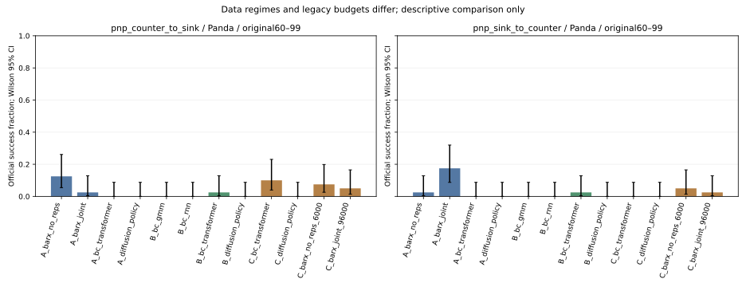
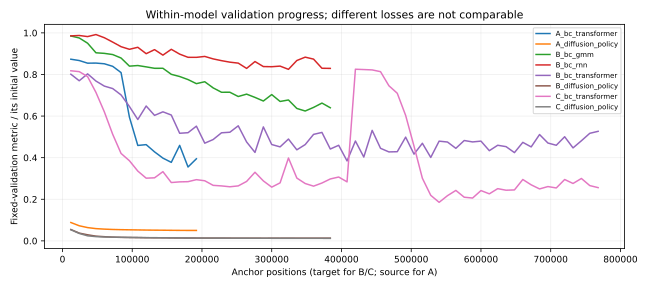

# Baseline真实执行结果

状态：**ACTUAL_BENCHMARK_RUNNING**。已关闭 0 个正式评测格、0 个episode。训练日志设置 8/8，选模完成 8/8。

只统计新冻结官方60–99条件；每任务每机器人每设置40次。旧P0–P3和开发smoke不加入成功率。技术错误另列，不填0%。原始小型结果见[逐episode结果](../results/baselines/episodes.csv)、[主表](../results/baselines/cells.csv)、[训练预算](../results/baselines/training_budgets.csv)、[checkpoint索引](../results/baselines/checkpoint_index.csv)。

本文件是执行中的真实快照，不能作为完整Benchmark结论。

## Group A：零目标示范迁移

| 设置 | Counter→Sink | Sink→Counter |
| --- | --- | --- |
| BARX No Reps source | 未完成（不填0%） | 未完成（不填0%） |
| BARX Joint source | 未完成（不填0%） | 未完成（不填0%） |
| BC-Transformer source-only | 未完成（不填0%） | 未完成（不填0%） |
| Diffusion Policy source-only | 未完成（不填0%） | 未完成（不填0%） |

## Group B：仅目标学习

| 设置 | Counter→Sink | Sink→Counter |
| --- | --- | --- |
| BC-GMM target-only | 未完成（不填0%） | 未完成（不填0%） |
| BC-RNN target-only | 未完成（不填0%） | 未完成（不填0%） |
| BC-Transformer target-only | 未完成（不填0%） | 未完成（不填0%） |
| Diffusion Policy target-only | 未完成（不填0%） | 未完成（不填0%） |

## Group C：源+目标学习

| 设置 | Counter→Sink | Sink→Counter |
| --- | --- | --- |
| BC-Transformer source+target | 未完成（不填0%） | 未完成（不填0%） |
| Diffusion Policy source+target | 未完成（不填0%） | 未完成（不填0%） |
| BARX No Reps legacy LoRA6k | 未完成（不填0%） | 未完成（不填0%） |
| BARX Joint legacy LoRA96k | 未完成（不填0%） | 未完成（不填0%） |

Group C历史BARX使用原LoRA权重，其目标划分、初始化、分辨率、样本量与新BC/DP不同，不构成等预算排名。

## UR5e源具身参考

| Source-only设置 | Counter→Sink | Sink→Counter |
| --- | --- | --- |
| BARX No Reps source | 未完成（不填0%） | 未完成（不填0%） |
| BARX Joint source | 未完成（不填0%） | 未完成（不填0%） |
| BC-Transformer source-only | 未完成（不填0%） | 未完成（不填0%） |
| Diffusion Policy source-only | 未完成（不填0%） | 未完成（不填0%） |

## 真实训练预算

新模型共享100条Panda示范池（每任务50），实际90条训练、10条整示范验证；源池1800条为IIWA/Kinova3/UR5e每任务每机器人300条，实际1620/180。B/C架构配对的目标采样序列、更新次数和目标暴露相同，C另加同量source，因此总样本/计算不相等。anchor不等于展开后的图像/标签总数；精确覆盖见各training目录的demonstration_coverage.csv与consumption_summary.json。

| 设置 | target anchor | source anchor | 实际更新 | 实际独立demo | 实际batch | 参数M | GPU占用墙钟秒 | 峰值GiB | 终止/状态 |
| --- | --- | --- | --- | --- | --- | --- | --- | --- | --- |
| A_bc_transformer | 0 | 192000 | 12000 | {'source': 1620, 'target': 0} | 16 | 30.57 | 662.6 | 1.57 | VALIDATION_NO_FURTHER_GAIN |
| A_diffusion_policy | 0 | 192000 | 12000 | {'source': 1620, 'target': 0} | 16 | 100.27 | 532.1 | 2.31 | VALIDATION_NO_FURTHER_GAIN |
| B_bc_gmm | 384000 | 0 | 24000 | {'source': 0, 'target': 90} | 16 | 13.18 | 301.2 | 0.44 | VALIDATION_NO_FURTHER_GAIN |
| B_bc_rnn | 384000 | 0 | 24000 | {'source': 0, 'target': 90} | 16 | 14.48 | 1222.8 | 1.32 | VALIDATION_NO_FURTHER_GAIN |
| B_bc_transformer | 768000 | 0 | 48000 | {'source': 0, 'target': 90} | 16 | 30.57 | 2654.0 | 1.57 | VALIDATION_NO_FURTHER_GAIN |
| B_diffusion_policy | 384000 | 0 | 24000 | {'source': 0, 'target': 90} | 16 | 100.27 | 1128.6 | 2.31 | VALIDATION_NO_FURTHER_GAIN |
| C_bc_transformer | 768000 | 768000 | 48000 | {'source': 1620, 'target': 90} | 32 | 30.57 | 4579.2 | 2.52 | VALIDATION_NO_FURTHER_GAIN |
| C_diffusion_policy | 384000 | 384000 | 24000 | {'source': 1620, 'target': 90} | 32 | 100.27 | 1314.0 | 2.48 | VALIDATION_NO_FURTHER_GAIN |

固定验证曲线的只读诊断（不同loss不直接比较；未据此更换权重）：

| 设置 | 指标 | 初始 | 历史最小值及anchor | 选定末步值 |
| --- | --- | --- | --- | --- |
| A_bc_transformer | expected_action_mse | 0.219386 | 0.077927 @ 180000 | 0.086592 |
| A_diffusion_policy | ema_fixed_noise_mse | 1.236552 | 0.061982 @ 192000 | 0.061982 |
| B_bc_gmm | expected_action_mse | 0.159573 | 0.099630 @ 348000 | 0.102119 |
| B_bc_rnn | expected_action_mse | 0.159079 | 0.131192 @ 324000 | 0.131912 |
| B_bc_transformer | expected_action_mse | 0.193865 | 0.074522 @ 408000 | 0.102114 |
| B_diffusion_policy | ema_fixed_noise_mse | 1.243618 | 0.016060 @ 288000 | 0.016283 |
| C_bc_transformer | expected_action_mse | 0.193865 | 0.035929 @ 540000 | 0.049620 |
| C_diffusion_policy | ema_fixed_noise_mse | 1.243618 | 0.014977 @ 384000 | 0.014977 |

验证平台表示最近窗口未继续改善，不保证全局充分收敛；若末步较历史验证最小值恶化，也原样保留末步规则和历史checkpoint。训练CSV的learning_rate字段记录scheduler更新后的下一步LR；DP首个实际optimizer步骤LR为0，未回写原始CSV。

目标HDF每条ep_meta中的robot0_agentview_left与冻结评测barx_panda_agentview名称不同，但全部100条的基座相对位置、旋转、45°FOV及180×320分辨率均核对一致，见camera_calibration_audit.json；未用默认相机名称臆断视角不一致。

GPU秒是该模型单GPU占用的训练墙钟时间（包含数据等待和验证），不是CUDA kernel累计时间。验证每12k固定256 anchors，最终checkpoint来自预先冻结的验证延长/末步规则，未用最终测试挑选。预算到顶仍改善须标为BUDGET_LIMITED_NOT_CONVERGED；验证平台也不证明全局充分收敛。

BARX source prior复用官方50k更新权重，不把其原始大规模预训练当作本轮训练。No Reps6k旧LoRA为3000更新/batch2、3068 target+2932 source；逐图像SHA回溯全部3068 target实际覆盖18条示范（95条eligible池）；2932 source样本完整回溯为19条三具身源示范。Joint96k旧LoRA为12000更新/batch8、48412 target+47588 source，实际100 target及115 source demos，source三具身均有。旧LoRA不是官方充分全参数适配。

## 同条件配对与稳定性

配对正式结果尚未完成。

新BC/DP每设置只有一个训练seed，40条件CI衡量本次测试集不确定性，不能据此宣称跨训练seed的稳定排序或跨场景泛化。配对检验为描述性、未做多重校正；加入source的结论只适用于该共享动作/观测、目标暴露匹配且C计算更多的设定。

## 本次观测到的最佳值

BARX历史LoRA在C表单独保留，不能和新C模型忽略预算差异宣称总体最强。

## 推理与资产

独占GPU、同一旧开发图像的16次warmup+80次策略调用见[latency](../results/baselines/latency/)。平均每控制步和fresh-query时间分开，chunk8缓存不会被当作每步完整推理；正式并发评测耗时不作独占延迟比较。

服务器执行根目录：`/home/users/lemon/baseline-benchmark/run-20261109`。完整视频、原生输出、12维实际控制、TCP、夹爪、物体轨迹及接触均在formal/，仓库[视频索引](../results/baselines/video_index.csv)和[所有外部文件SHA256](../results/baselines/external_files.csv)保留绝对路径。

独占GPU实测推理（ms）：

| 设置 | 均值/控制步 | p95/控制步 | 均值/新query | 峰值GiB |
| --- | --- | --- | --- | --- |
| A_barx_joint | 8.38 | 66.92 | 67.01 | 2.82 |
| A_barx_no_reps | 8.31 | 66.58 | 66.47 | 2.82 |
| A_bc_transformer | 3.48 | 4.03 | 3.48 | 0.25 |
| A_diffusion_policy | 4.00 | 29.47 | 29.79 | 0.90 |
| B_bc_gmm | 1.55 | 2.12 | 1.55 | 0.07 |
| B_bc_rnn | 1.64 | 2.18 | 1.64 | 0.07 |
| B_bc_transformer | 3.36 | 3.89 | 3.36 | 0.25 |
| B_diffusion_policy | 3.97 | 29.14 | 29.78 | 0.90 |
| C_barx_joint_96000 | 8.40 | 67.27 | 67.14 | 2.82 |
| C_barx_no_reps_6000 | 8.33 | 66.72 | 66.57 | 2.82 |
| C_bc_transformer | 3.42 | 4.16 | 3.42 | 0.25 |
| C_diffusion_policy | 3.91 | 29.28 | 29.17 | 0.90 |
