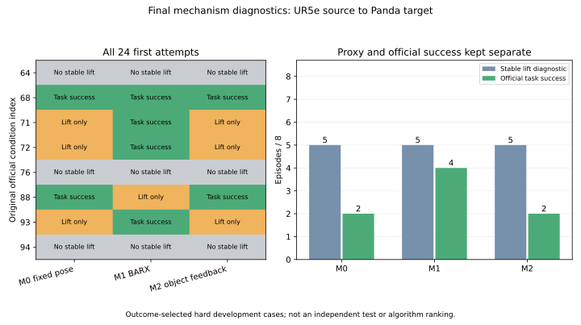

# 最后24次机制验证：实际结果与立项决定

**已完成24/24次真实MuJoCo干预，新增训练0次、重跑0次。结论：本轮新算法开发NO-GO。** 共同抓取前缀稳定抬升5/8；官方完整任务M0 **2/8**、M1 **4/8**、M2 **2/8**。预注册A门槛要求稳定抓持至少6/8且一个普通控制器完整任务至少4/8，两项均未达到。

冻结提交：[64a8c31afadcb9f34e662516d8fc23804ec72519](https://github.com/LemonQC/tempcross/commit/64a8c31afadcb9f34e662516d8fc23804ec72519)。在首次新物理动作前已通过GitHub接口回读配置、执行代码和源轨迹索引；[冻结凭据](../results/mechanism/frozen_publication.json)保存时刻与协议SHA256。执行器在加载原始checkpoint及核对全部冻结哈希后才启动。

这是按既有失败结果选出的困难开发诊断集，**不是新的独立测试集，不报告泛化性能或论文统计结论**。

## 真实逐条件结果

固定任务 `pnp_counter_to_sink`，UR5e→Panda；全部使用Panda各自原始官方冻结状态。每格一个首次物理episode，20Hz、全局最多600步，保留官方物理参数、夹爪、碰撞和成功标准。升高使用与历史记录一致的物体body原点世界z；协议中的COM措辞实际按此实现，没有另外测量惯性质心。

| 原始条件 | 稳定抓持/交接 | M0官方完整任务 | M1官方完整任务 | M2官方完整任务 | 实际失败阶段 |
| --- | --- | --- | --- | --- | --- |
| 64 | 否 | 0/1 | 0/1 | 0/1 | 三方法均在预抓取160步上限停止；总189步，未闭爪 |
| 68 | 是，第240步 | 1/1，498步 | 1/1，444步 | 1/1，500步 | 无 |
| 71 | 是，第240步 | 0/1，370步 | 1/1，579步 | 0/1，370步 | M0/M2搬运130步上限 |
| 72 | 是，第236步 | 0/1，366步 | 1/1，517步 | 0/1，366步 | M0/M2搬运130步上限 |
| 76 | 否 | 0/1 | 0/1 | 0/1 | 三方法均在预抓取160步上限停止；总188步，未闭爪 |
| 88 | 是，第246步 | 1/1，408步 | 0/1，600步 | 1/1，409步 | M1抓取后BARX耗尽全局600步，未放置 |
| 93 | 是，第242步 | 0/1，372步 | 1/1，558步 | 0/1，372步 | M0/M2搬运130步上限 |
| 94 | 否 | 0/1 | 0/1 | 0/1 | 三方法均已到抓取位姿并短暂双指接触，但抬升失败；总305步 |

交接索引采用“动作t前的状态t”。未完成抓取的64、76、94没有交接，不伪造交接快照；这些格计入各方法8次总数，且M1在这些格没有调用BARX。

| 分阶段计数 | M0 | M1 | M2 |
| --- | --- | --- | --- |
| 到达初始避让 | 8/8 | 8/8 | 8/8 |
| 到达预抓取 | 6/8 | 6/8 | 6/8 |
| 出现物理双指接触 | 6/8 | 6/8 | 6/8 |
| 稳定抬升并完成交接 | 5/8 | 5/8 | 5/8 |
| 抓持中水平搬运≥10cm（诊断代理） | 5/8 | 5/8 | 5/8 |
| 官方放置子条件 | 2/8 | 4/8 | 2/8 |
| 官方放置且末端退离，完整success | **2/8** | **4/8** | **2/8** |

## 已核对的可比性和源操作

从已有1280次Benchmark逐条件结果复核：UR5e Joint成功而Panda全部12设置失败的确为 `[64,68,71,72,76,88,93,94,97,99]`，本轮仅前8个。没有新生成专家，也没有重新运行源策略。

源/目标每个条件的物体资产相同。读取实际物体和水槽body姿态后确认：这8个场景水槽变换差值为0；物体初始位置最大差约8.434微米，旋转最大差6.6601e-5弧度。控制代码仍分别使用实际物体坐标系和水槽坐标系，不依赖假定世界坐标相同。[完整场景核验](../results/mechanism/scene_audit.json)保留双方condition ID、状态/XML/metadata哈希、资产与坐标变换。

| 条件 | 首次闭爪动作 | 首次10状态稳定双指接触开始 | 首次10状态接触且升高≥3cm开始 | 源释放事件索引 |
| --- | --- | --- | --- | --- |
| 64 | 168 | 180 | 201 | 328，开爪 |
| 68 | 160 | 169 | 202 | 328，开爪 |
| 71 | 160 | 169 | 197 | 424，开爪 |
| 72 | 208 | 216 | 274 | 472，开爪 |
| 76 | 184 | 193 | 215 | 328，开爪 |
| 88 | 200 | 225 | 355 | 488，开爪 |
| 93 | 136 | 145 | 177 | 360，开爪 |
| 94 | 168 | 177 | 195 | 360，最后双指接触丢失，**没有开爪命令** |

物体相对TCP抓取位姿、完成抓取时TCP/物体/夹爪状态、全部搬运/释放/退离轨迹及物体↔水槽变换均已提取。[源操作bank](../results/mechanism/source_contact_bank.json)和[源原始/提取数据索引](../results/mechanism/source_artifact_index.csv)给出绝对路径、大小、SHA256。

条件94尤其说明接触代理的限制：源轨迹官方成功，旧指垫 `_check_grasp` 却始终为假，原始日志显示左右**指尖**夹持。首次新仿真前已冻结接受每侧既有指垫或指尖接触、距离≤0的物理诊断，同时继续保存旧代理。官方任务判据从未改动。Panda条件94在close阶段有8个双指接触状态，lift阶段仅1个，物体最大上升约2.203mm；TCP却到达了抬升目标附近。这里是**接触未能维持并带动物体**，不是把“发出闭爪/抬升命令”当成成功。

## 三对照实现与数值审计

M0是PRIVILEGED_REFERENCE：用源物体相对抓取，抓取后固定交接时的物体→TCP附件变换，持续OSC跟踪源水槽坐标映射的固定参考。M2也是PRIVILEGED_REFERENCE：相同目标、增益、释放和退离规则，只在抓取后逐步重观测物体→TCP变换，形成实际物体误差反馈。两者都是普通控制，不是本项目新算法。

M1前三阶段与M0/M2完全相同；只有确认稳定抬升后才清空原始BARX Joint队列并接管。BARX实际接口严格只有RGB与原任务指令，8动作chunk；没有真值物体状态或新增学习模块。checkpoint仍为原始50K Joint，SHA256为 `ffce76802a8e75d4806b30dee43624accf2c4de4213c17059457e34a8243efce`；大小、服务器位置及零训练更新见[权重索引](../results/mechanism/checkpoint_index.json)。

审计已完成：

- 24个恢复初态全部符合各自原官方状态哈希；同条件三方法初态逐值完全相等，模型XML相同。
- 24条前缀的每一步动作及完整flattened仿真状态比较，最大数值差 **0**；15个真实交接的MuJoCo integration state、warm-start、本体观测和数值控制器/夹爪字段比较，最大差 **0**。见[逐格核验](../results/mechanism/prefix_audit.csv)。
- 每次交接保存完整 `mjSTATE_INTEGRATION`、控制器/夹爪、本体观测、RNG和清空的策略队列；没有恢复交接状态来分叉或瞬移。
- 24个H5均有steps+1状态和steps动作，所有检查数值有限、接触记录齐全、telemetry error为0；24个视频全部逐帧解码，320×180、20fps、帧数等于实际动作数。见[视频核验](../results/mechanism/video_validation.json)。
- 15个交接点的离线几何雅可比与保存的真实控制器雅可比核对，最大差2.332e-15；不新建仿真、不做IK搜索。见[核验](../results/mechanism/jacobian_audit.json)。4项非物理控制测试通过。

## 必须承认的执行预算限制

我在首次运行前固定的预抓取160步、搬运130步上限，对这些长距离运动偏紧。这是本实现的限制，不能归咎为硬件不可达，也不能据此声称经典控制本身失败。

64/76停止时位置误差分别46.3/29.9mm，但最后约1秒仍移动56.5/36.6mm；71/72/93的M0搬运停止时误差203.1/139.2/221.1mm，最后约1秒仍移动57.0/57.2/57.8mm。终止时没有记录到非预期碰撞，关节边界也没有被逼近；局部雅可比条件数约9.4–17.4。**证据说明运动被冻结的阶段时限截断，没有证明目标位姿不可达。** 这些局部量也不能证明全局可达性。

本轮修复了P3“未到目标就按时间跳入下一阶段”的问题；到达前不会推进，但采用了超时停止。因此仍有有限执行预算造成的删失，不能把它包装为彻底排除了跟踪滞后。按专家禁止第二轮阈值搜索的要求，保留这24个首次结果，没有延长时限或增大动作后重跑。[原始跟踪与运动诊断](../results/mechanism/recorded_tracking_diagnostics.csv)可复核这些限制。

## 科研判断及本轮边界

1. **A未通过，当前新算法开发NO-GO。** 稳定抓持5<6，普通控制完整任务2<4。它只是否定本轮冻结方案通过门槛，不是否定机器人或其他常规控制方案的物理能力。
2. **抓取建立是有实测依据的优先问题。** M1在68、71、72、93成功，原先这些条件所有12个Panda设置均失败。5个成功交接中有4个由原始BARX继续完成，说明它并非普遍缺少抓取后任务能力。此条件成功率4/5只描述已成功抓取的子集，不能代替总体4/8。M1达到B的计数，但A前置门槛未过，不据此启动算法原型。
3. **不支持优先立项抓取后真值反馈替代。** M0与M2官方成功条件完全相同，均为68、88，净改善0。88的M1失败又说明抓取后并非永远没问题；只是目前没有证明物体反馈新模块必要。
4. **尚无必须靠新算法解决的独有缺口。** 当前证据支持接触保持和执行时间预算是具体工程问题；普通控制在2个条件有效，纠正抓取加原策略在4个条件有效。标准适配本轮没有重训，不能拿此次诊断否定其充分性。
5. 已完成[MimicGen、KITE、CrossZero、Track2Act、视觉伺服/MPC及TrAct的创新性对照](MECHANISM_PRIOR_ART.md)。仅把真值改为视觉估计、接触意图加具身解码、物体流加残差或VLA候选加视觉效果评分，都有直接先例；本轮也未验证可区分的新决策机制。
6. **没有启动 `research_v0/`、前向/反向、新方法smoke或大规模训练。** 原型的前提未满足，这些项目明确为NOT_TRIGGERED，不伪称完成。总新增物理episode严格24，不使用“smoke”名义加第25次；不再追加Baseline或前期阈值试验。

## 原始结果与复核入口

- 小型逐条件结果：[analysis.json](../results/mechanism/analysis.json)、[episodes.csv](../results/mechanism/episodes.csv)、[stages.csv](../results/mechanism/stages.csv)、[decision.json](../results/mechanism/decision.json)。
- 全部新原始记录根目录：`/home/users/lemon/mechanism-20261110/`。
- 每格路径：`condition-<064等>/M0|M1|M2/telemetry/episode-000.h5`，同名`.jsonl`为原始接触；`history.json`为阶段/官方success，`rollout.mp4`为视频，`prefix.npz`为实际前缀。
- 仅真实交接格具有 `handoff.npz`、`handoff_runtime.pkl`、`handoff.json`；后者记录交接动作索引和清空队列。原始模型可由官方冻结XML、metadata与checkpoint索引重建。
- 全部大文件/日志绝对路径、大小、SHA256：[external_files.csv](../results/mechanism/external_files.csv)；源成功轨迹另见[source_artifact_index.csv](../results/mechanism/source_artifact_index.csv)。
- 代码：`mechanism_validation/`；首次冻结协议：[MECHANISM_PROTOCOL.md](MECHANISM_PROTOCOL.md)与[配置](../configs/mechanism_protocol.json)。离线审计命令：`python -m mechanism_validation.collect`、`python -m mechanism_validation.recorded_diagnostics`、`python -m mechanism_validation.plot`，均不调用物理step。

原1280次Baseline及P0–P3代码、配置、实验和结果均保留。相对基准仅增加本轮文件及专家指令，并更新README/忽略规则入口；保存情况见[preservation_audit.json](../results/mechanism/preservation_audit.json)。
