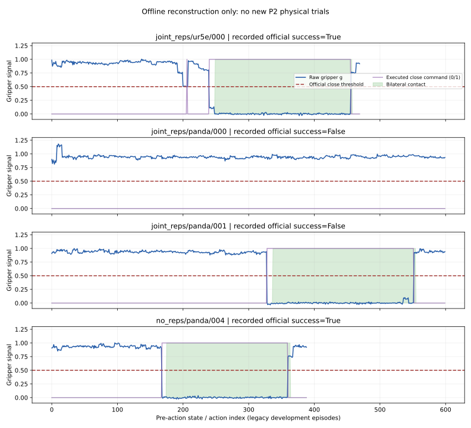

# P2-A：实际离线诊断，因果验证尚未完成

状态：`PARTIAL_P2_A_OFFLINE_OLD_TRAJECTORIES`。本次实际读取原 P1 的 80 条开发轨迹，重建指垫/TCP/物体位姿并导出动作、指关节和接触时序；没有新增训练或仿真。原始输入为条件 0–19，不是新测试条件 20–39。

## 已完成及证据

- 可执行源码：`p2_validation/offline_audit.py`，只导入文件、XML、NumPy/HDF5 工具，不导入 MuJoCo、机器人环境或策略。
- 80 条逐次结果：[episodes.csv](../evidence/p2/offline_audit_verified/episodes.csv)。完整指标：[summary.json](../evidence/p2/offline_audit_verified/summary.json)。
- 输入文件及哈希：[input_files.csv](../evidence/p2/offline_audit_verified/input_files.csv)。涵盖 HDF5、接触 JSONL、官方逐次记录及冻结条件 JSON/NPZ。
- 完整逐动作时序保留在服务器 `/home/users/lemon/coft-p2/p2/offline-audit-20261108-verified/`；80 个 gzip CSV 的绝对路径、大小和 SHA256 见 [external_files.csv](../evidence/p2/offline_audit_verified/external_files.csv)。
- 逐动作导出原夹爪值、实际命令、真实指垫开口、六指关节状态、双指接触、物体升高、TCP 相对物体位姿及左右指垫世界位姿。四元数为 simulator 的 wxyz 顺序。
- 首次闭爪时刻、闭爪步数和视频绝对路径在逐次 CSV 中；索引使用动作前状态，避免视频帧和动作错位。
- 原动作到官方 normalize/invert/padding 后的前七维映射误差为 0。官方 success 标签只从原始官方 JSON boolean 读取，没有使用几何诊断替换任务成功。

关键时序图：



## 对 17 次未闭爪的实际发现

再次核实 Joint Reps/Panda 17 次全程没有正闭爪指令；原始夹爪值最低约 0.738，episode 中位数约 0.94。因此在原状态序列上将 0.5 阈值轻调为 0.6/0.7 不会触发闭爪。修改后的闭环收益仍未知。

使用冻结 XML 中指垫局部几何和逐步 finger body 的真实位姿，测量物体中心是否进入两指垫之间的狭窄棱柱，并要求指垫法向近似平行。17 次均未出现这个中心判据。

**不能将此结果写成“17 次均未到合法抓取区域”。** 该判据忽略物体的完整形状、离中心夹持、碰撞和摩擦，灵敏度不足：在原有 15 次官方成功中，只有 6 次曾满足它。因此它目前只能提供指垫坐标诊断，不能作为 B2 的 Oracle，也不能证明其余时刻不可抓。代码和 JSON 均保留 `legal_grasp_opportunity=UNKNOWN_REQUIRES_PHYSICAL_COUNTERFACTUAL`。

| 原方法/机器人 | 官方成功 | 成功中出现中心棱柱判据 | 双指接触且升高 3cm 连续至少 10 状态步的条数 |
|---|---:|---:|---:|
| No Reps / UR5e | 5/20 | 2/5 | 5 |
| No Reps / Panda | 1/20 | 1/1 | 1 |
| Joint Reps / UR5e | 9/20 | 3/9 | 9 |
| Joint Reps / Panda | 0/20 | N/A | 1 |

接触与升高组合仍是事后阶段代理，不是力闭合证明。Joint Reps/Panda 的唯一此类事件对应此前有抓持、运输但未通过放置/退离条件的案例。已有完整阶段失败分类在 `docs/TRANSFER_FAILURES.md`，本次没有据新阈值改写它们。

## 尚未完成的诊断及最小反事实

目前不能确定 17 次未闭爪究竟来自未到达有效抓取姿态，还是已存在可抓机会而策略拒绝闭爪。需要加入物体碰撞几何/指垫扫掠空间，并在旧开发条件的候选时刻进行真实短时闭爪反事实，观察实际接触与物体随动。恢复分支点还需核对控制器状态，不能只设置 qpos/qvel 即宣称精确反事实。

本次按用户“先不运行训练或仿真”的限制，没有执行该干预，也没有启动 segmentation 渲染、完整可见面积诊断或 B2。P2-A 只完成离线部分，不能称为完整因果审计。

复算命令（纯文件分析，输出须用新目录）：

```bash
/home/users/lemon/coft-p2/barx/.venv/bin/python -m p2_validation.offline_audit \
  --root /home/users/lemon/coft-p2/rollouts/user-authorized-resume \
  --source /home/users/lemon/coft-p2/barx \
  --out /tmp/p2-offline-recheck \
  --external /tmp/p2-offline-recheck-timeseries
```
