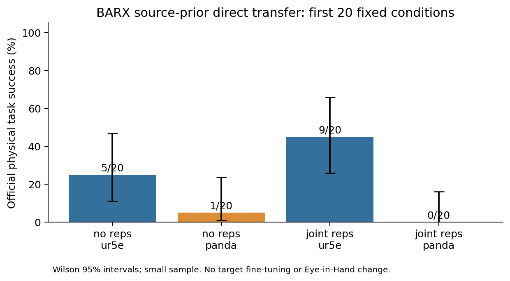

# COFT-P2 官方 BARX 跨具身闭环验证报告

执行日期：2026-11-07（Toronto；结束为 2026-11-08 UTC）。基于 `808f0ab19b1fb0be6bbc9f20445744ab8db8b87a` 延续，保留此前 v0/v1 与初次受阻记录。

**实际状态：P0_PASSED / P1_COMPLETE，80/80 次正式闭环物理仿真完成。主判断：`CROSS_EMBODIMENT_GAP_OBSERVED`。这支持继续做受控目标适配对照，不足以批准 COFT 新学习算法或 T-RO 创新性立项。**

此前 `d6944351e4188c71fdf254e9c5d8b9e0120a6f47` 的 P0_BLOCKED 是第一次停止时的真实状态。用户随后明确要求继续安装，本次已解决环境与资源问题。没有把安装失败当作科研假设失败，也没有覆盖第一次结果。

## 1. 完整物理结果

| 方法 | 机器人 | 成功/完成 | 成功率 | Wilson 95% 区间 |
|---|---|---:|---:|---|
| No Reps XP-900 | ur5e | 5/20 | 25% | 11.2%–46.9% |
| No Reps XP-900 | panda | 1/20 | 5% | 0.9%–23.6% |
| Joint Reps XP-900 | ur5e | 9/20 | 45% | 25.8%–65.8% |
| Joint Reps XP-900 | panda | 0/20 | 0% | 0.0%–16.1% |

P0 的 Joint Reps：UR5e 成功，470 步；Panda 未成功，600 步。两次都是有效完整 rollout，日志和视频通过检查，因此允许进入 P1。**P0 不计入上表**；实际共运行 82 次，P1 80 次共有 45,319 个动作步。82 段视频完整解码共 46,389 帧，每段帧数与官方步数一致。



两个方法的源减目标差分别为 20 和 45 个百分点。将组间数据按非严格配对二项样本处理的**事后探索性**双侧 Fisher p 分别为 0.181764 和 0.001229；两个源—目标比较做 Bonferroni 校正后为 0.363528 和 0.002457。No Reps 的差异不能称为已达统计显著；Joint Reps 的差距更强。固定前20条件、物体/布局相关性和非严格配对限制这些 p 值的推断范围，不能当作有充分统计功效的确认性论文实验。两个方法反复使用同一20场景，不把40次简单当作独立场景样本合并检验。

`success` 直接取官方 `info["is_success"]["task"]`。官方评估在首次满足时结束，因此这里 `success_once=success`，没有独立的终末/长期稳定成功率。判据为目标与 sink 的 `obj_inside_of(..., partial_check=True)`，且 EEF—物体距离 **>0.1 m**。它允许部分进入且不检查成功后的长期静置，不能改称更严格的稳定完全放置。本报告未更改该判据。

## 2. 固定代码、模型、输入与预算

- 官方 [BARX](https://github.com/ajaysridhar0/barx) commit：`0f435089f48b1f16d225f868dbef855a5e75d1e0`；实际源工作树干净。完整源码位于 `/home/users/lemon/coft-p2/barx`。
- 任务仅 `pnp_counter_to_sink / XPnPCounterToSink`；UR5eOmron + 官方默认 Robotiq85Gripper；PandaOmron + Robotiq85Gripper。原生不同的6/7关节物理模型和官方初态，没有人为设置相同关节状态。
- 保持 `barx_ur5e_agentview` / `barx_panda_agentview` 第三人称输入，320×180及官方预处理；`use_wrist_image=false`。没有 Eye-in-Hand、额外相机或策略输入改动。
- 两方法均为 source-prior action-only 推理：未传表征选项（官方原始config为 `null`，协议中的 `none` 表示无额外表征提示），统计 key `mg_pnp_lite`，相同 VQ tokenizer，动作块8，最多600个策略动作步，官方等待10步/冻结已稳定初态协议，global seed=7。无量化替代、无训练、无新规划器。
- Joint Reps：HF revision `191da4c06c1050767a0379feb67a5c20e85bd703`，`step-050000-epoch-15-loss=0.2577.pt`，5,554,882,540 bytes，SHA256 `ffce76802a8e75d4806b30dee43624accf2c4de4213c17059457e34a8243efce`。
- No Reps：revision `9ebc6f6fb8311f3c4394cd77811a4025b26d0a62`，`step-050000-epoch-15-loss=0.8424.pt`，同尺寸，SHA256 `ccbd2099903ba7c307b9c47586634754ce34b6269b8577e0040ca0a2f3ca8df3`；与固定 revision 的 HF LFS 元数据一致。
- VQ revision `7d50d28628237c499eb8488e1cf91aab8acbaec6`，SHA256 `cbf410959839f99ee131aa8c7d4c2dc2116d134f23ee9e88e90fa089270e7378`。DINO/SigLIP/Qwen 也按官方清单固定 revisions，已校验缓存 LFS hashes；四类完整官方厨房资产通过官方 SHA256。仅下载推理物料，没有 RLDS 训练集或未使用的 base-VLM 大 checkpoint。

按官方发布训练来源，UR5e 包含在 XP-900 源预训练中，Panda 是该源预训练未包含的目标。本轮未下载训练数据做逐条数据溯源，不保证基础 VLM 从未见过任何 Panda 图像。**这不是 BARX 完整目标微调实验，也不是论文最终性能复现**。

各机器人按官方 bundle 原顺序取前20条，无替换失败、换 checkpoint 或后验挑选种子。真实 seeds 为 `1000,1002,1004,1005,1009,1010,1011,1012,1013,1014,1015,1016,1017,1019,1024,1025,1026,1028,1029,1030`。官方 episode 日志的 seed 字段使用 start_seed+index，可能不是真实 seed；交付 CSV 同时保存 `reported_seed` 与从冻结条件读取的 `actual_seed`，以 condition_id 联接。

## 3. 场景公平性与可复现性

40个跨机器人对应条目均有相同物体/布局/材质语义配置（类别集合列表顺序归一化后），初始目标位置差最大 7.58 微米；全部非机器人 body 位置差最大 0.182 毫米；相机矩阵元素差最大 4.08e-8。两方法在同一机器人的40组初始条件，目标/非机器人 body 位姿与相机矩阵差均为0。

这些测量支持场景近似对应，**仍按非严格配对评测报告**，不将逐场景表现差异认作已隔离的因果效应。官方不同本体还包含不同初始化和安装偏移：`BARX_ROBOT_POSITION_OFFSETS` 中 UR5e 为 `[0.4,-0.1,0.2]`，Panda 为 `[0.4,-0.06,0.2]`；控制器均为官方 base-frame delta `OSC_POSE`。因此差异不只是“6 vs 7 DOF”，还包含臂几何、物理响应、初始姿态/安装与图像中的机器人外观。

P0 与 P1 的 Joint Reps 首个相同条件重放，在两种机器人上均有**完全相同**的完整动作、qpos、EEF及物体轨迹（最大逐项差为0）。这验证工程可复现性，不增加统计独立样本数。见 `p0_audit.json` 和 `physical_pairing_audit.json`。

## 4. 失败阶段与技术解释

| 方法/机器人 | GRASP_ALIGNMENT | OBJECT_DROP | PLACEMENT_ERROR |
|---|---:|---:|---:|
| no_reps/ur5e | 15 | 0 | 0 |
| no_reps/panda | 19 | 0 | 0 |
| joint_reps/ur5e | 9 | 2 | 0 |
| joint_reps/panda | 19 | 0 | 1 |

P1 的65个失败均计算完整状态/动作指标，并进行带标记的视频抽帧核查；P0 Panda 的重复失败也核查，未混入65次计数。分类描述可观察的失败阶段，不等于识别了唯一根因。`GRASP_ALIGNMENT` 在此含抓取包围/对齐与闭合时机失败；不能仅因该标签宣称 IK 失败。

| 方法/机器人 | 接近≤10cm | 双指接触记录 | 中心升高≥5cm | 失败中从未闭爪 | 失败中距臂关节限位<0.01rad |
|---|---:|---:|---:|---:|---:|
| no_reps/ur5e | 20/20 | 6/20 | 5/20 | 7/15 | 0/15 |
| no_reps/panda | 18/20 | 1/20 | 3/20 | 16/19 | 2/19 |
| joint_reps/ur5e | 20/20 | 11/20 | 8/20 | 3/11 | 0/11 |
| joint_reps/panda | 18/20 | 1/20 | 2/20 | 17/20 | 2/20 |

接近距离、双指接触和中心升高是**事后阶段诊断**，不替代任务成功或稳定抓持判据；升高可能来自推倒/翻转，双指接触也不保证力闭合。合理预抓姿态没有另一个经过验证的6D oracle，使用视频与状态联合审查，不伪造其真值。官方未暴露独立连续任务进度，本轮交付这些带局限的阶段证据。

主要发现：

1. 源/目标多数失败发生在抓取获取阶段，而非已经抓持后的规划搬运。No Reps 的源/目标失败中分别7/15、16/19从未闭爪；Joint Reps 为3/11、17/20。策略原始7-D动作到环境12-D动作的逐步映射、夹爪归一化/反号与 padding，在全部80条轨迹的最大误差均为0。没有证据把它们统一归为接口转换错误。
2. 两个 UR5e/Joint Reps 例子属于短暂抬升后丢失：`006` 胡萝卜在闭爪命令下失去接触，随后最高上升约4cm并落回台面；`011` 香蕉上升约7.3cm、尚未到水槽时提前开爪落回台面。两者均未成为成功搬运。
3. `joint_reps/panda/001` 抓持黄瓜218个状态步、抬升约11.1cm、搬向水槽并释放，随后末端距离最多8.43cm，最终8.326cm，始终未满足官方>10cm退离条件。单独的 `obj_inside` 布尔值未记录，不宣称它通过；但退离条件失败已经足以解释未达成功。这是应该优先检查简单控制修正的具体案例，不能当成学习算法必要性证据。
4. `no_reps/panda/004` 在389步完成真实抓取搬运释放，是有效目标成功参考；同一目标场景并非所有策略都失败。Panda 仿真不是整体不可用。
5. 两种源策略的全部失败都未接近所记录的臂关节限位；两种目标策略各只有2个失败的最小限位裕量<0.01rad，目标成功例也曾接近限位。限位事件不能解释大多数失败，也不能仅凭接触记录将普通手指/自接触命名为致因碰撞。本轮未确认以 COLLISION、REACHABILITY_OR_EXECUTION 或 POLICY_ACTION_MISMATCH 为主因的案例；这不等于证明它们不存在。

完整65条分类、逐例数据和案例解释见 [TRANSFER_FAILURES.md](TRANSFER_FAILURES.md) 与 `video_reviews.json`。视频审查是抽帧加完整状态/动作核查，不冒充逐帧人工标注；碰撞因果、力闭合和不可达性仍可能需要独立干预验证。

## 5. 六个最终问题与科研判断

1. **官方仿真是否真正运行？** 是，独立 BARX 环境完成 P0 和固定80次 P1，82段真实官方视频均完整解码。实际 GPU 为 RTX 3090 24GB，不是4090；CUDA、FlashAttention GPU内核、NVIDIA EGL均已验证，无 ROS、无真机。
2. **四组结果？** No Reps：UR5e 5/20、Panda 1/20；Joint Reps：UR5e 9/20、Panda 0/20。区间见上表，不能把20次视为充分统计功效。
3. **主要失败阶段？** 源/目标均以未获得稳定抓持为主，伴随未闭爪/对齐失败；另外源有2次短暂抬升后丢失，目标 Joint 有1次放置/退离未完成。
4. **是否有可复现跨具身失效？** 有，尤其 Joint Reps 的源—目标经验差45个百分点；同条件首条源成功/目标失败已在 P0/P1逐状态复现。它是有限官方条件集上的源先验直接迁移现象，不是 COFT 的新颖性证明。
5. **是否可由简单控制或规划解释？** 局部有明确线索，例如8.3cm退离不足；整体未完成同信息控制/规划反事实，不能说已解决，也不能排除简单方法。动作映射无误、限位少见不能推出必须学习。
6. **是否应研究具身条件残差？** 可以作为下一阶段三项受控对照之一，**尚无不可替代性证据**。必须先和普通目标数据微调、几何可执行性修正在同数据/信息/预算下比较。当前不批准以“必须联合学习”为结论的 COFT/T-RO 算法立项。

本轮没有验证 Eye-in-Hand 动态可观测性或执行—观测联合学习。相机没有改变，但机器人外观、可能的本体遮挡与控制响应仍共同变化；中心在视锥内不等于目标可见面积足够，普通动作失败不能归因为遮挡。旧 COFT 仅对实际相机/物体状态做中心视锥投影，完全是事后诊断，不输入策略、不定义成功。

## 6. 执行、环境与交付

独立环境：`/home/users/lemon/coft-p2/barx/.venv`，Python3.10、Torch2.2.0+cu121、MuJoCo3.1.1、FlashAttention2.5.5。没有修改 cbl4090_clean 或其他既有环境。官方76项测试通过、无跳过；本项目22项测试通过。官方依赖元数据有4项冲突：protobuf官方 override 与 tensorflow-metadata/tianshou 声明不一致；robosuite声明的较新 MuJoCo/mink 与 BARX 自身固定版本不一致。保留官方 pins，实际本轮运行通过，**不宣称 pip check 干净**或所有机器人控制器均兼容。

安装修复仅涉及私有 uv 浅缓存有效 HEAD、校验哈希不变的镜像传输，以及官方 FlashAttention 预编译 wheel；官方任务/相机/模型/动作源码始终未修改。新 gate 会在写日志前拒绝非空结果目录。原始 P0_BLOCKED 文件留在 `results/simulation/` 根部；当前物理结果独立在 `results/simulation/closed_loop/`，安装证据在 `install_resume/`。

- 小型原始结果：各组官方 `config.json / episodes.jsonl / summary.json`、gate、逐次 JSON/CSV、区间图、配对审计、模型完整性、视频解码证明和索引。
- 大型物料：`/home/users/lemon/coft-p2/artifacts/`；完整原始状态/动作/接触/视频：`/home/users/lemon/coft-p2/rollouts/user-authorized-resume/`。`external_files.csv` 逐文件给出绝对路径、大小和 SHA256。所有权重、完整HDF5/JSONL与MP4均未上传 GitHub。
- telemetry 保存 qpos/qvel、关节/EEF/夹爪状态、物体/全部body位姿、原始动作块、执行动作、接触几何与实际相机变换；P1另记录仿真模型限位。特权状态只用于事后诊断。原始 telemetry 的 NumPy bool 可能写为字符串，成功率只读取官方 JSON bool；分析器拒绝字符串标签，防止把 `"False"` 当成真。

复现方式（从本仓库运行；下面的新目录重放示例未另跑第二轮80次）：

```bash
.venv/bin/python -m pytest -q
/home/users/lemon/coft-p2/barx/.venv/bin/python -m simulation_validation.verify_runtime \
  --out /home/users/lemon/coft-p2/install-resume/runtime-recheck.json
BARX_RUN_ROOT=/home/users/lemon/coft-p2/rollouts/reproduction-001 scripts/run_barx_gate.sh
scripts/analyze_barx_run.sh \
  /home/users/lemon/coft-p2/rollouts/user-authorized-resume \
  results/simulation/recomputed \
  /home/users/lemon/coft-p2/rollouts/user-authorized-resume/analysis/video_reviews.json
```

上述 `reproduction-001` 是重放示例目录，不是声称另外运行了一轮80次；实际唯一正式目录为 `user-authorized-resume`。视频抽帧可用 `python -m simulation_validation.review_sheets --analysis .../analysis.json --out .../review` 重建，审查意见本身须由可观察证据核查，不能自动凭失败结果生成。
