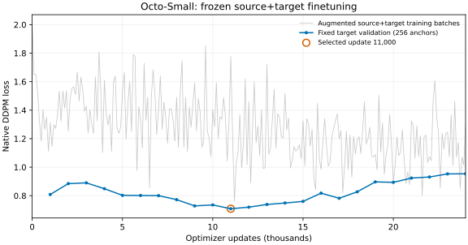

# Octo-Small source+target results

COMPLETE_FAITHFUL_PORT for one joint UR5e+Panda setting. Target-only was not run.
Original conditions60–99 are EXPOSED_REFERENCE, not independent unseen test. Official placement AND retreat is unchanged.

| Task | Official successes / episodes |
|---|---:|
| pnp_counter_to_sink | 0/40 |
| pnp_sink_to_counter | 0/40 |

Actual formal updates: 24000; discarded diagnostic updates:6; anchors:768000.
Selected update:11000, minimum fixed target-validation DDPM loss:0.70856063. No test-based selection.
Checkpoint:`/home/users/lemon/strong-baselines-20261112/octo_small/training/source_target/selected/11000/default/checkpoint`; SHA256:`628073b9e6439a2e800293e980dde908cf45bf92d3b3772571e0f4f9d6f99188`.

Official transformer, native diffusion head/loss, frozen T5, resize/augmentation and optimizer are unchanged. Differences from the generic official recipe are declared in PROTOCOL.md. Native RGB256/T5 pretraining differs from old RGB128 models; no additional robot state or real wrist camera is used.
Both development smoke episodes failed task success but passed full-length interface acceptance. They are separate from the80 formal episodes. Failure-stage labels describe recorded contact/placement predicates; they do not establish causes.
See results.json, episodes.csv, training_state.json, per-task acceptance files, native_action_audit.json and artifact_index.json. All large weights, raw telemetry and videos remain at their absolute server paths. Earlier baseline evidence and launches passed preservation checks.

Final optimizer audit independently confirmed Adam and schedule counters24000,
252 changed tensors and0 changed frozen-T5 tensors. Actual sample exposure is
768000 anchors/226829 unique demo-frame anchors across630 training demos.
Training took10638.95s (~2.96h). The5s whole-device monitor observed19254MiB
maximum (desktop overhead included; sampled maximum, not exact allocator peak).

All80 failures were classified CLOSE_WITHOUT_BILATERAL_CONTACT: close commands
were issued, but the saved contact criterion never observed both finger pads
contacting the object together. This is descriptive evidence, not identification
of the underlying cause. All12520 formal native queries matched the complete
normalized→physical→canonical→executed action chain. The251-file artifact index
was independently rehashed with no mismatch; no new simulation was used for acceptance.

| Joint source+target method | Counter→Sink | Sink→Counter |
|---|---:|---:|
| Existing ACT (reused) |8/40|2/40|
| Existing VQ-BeT (reused) |0/40|0/40|
| Octo-Small (new) |0/40|0/40|

These share the original official physical conditions and success criterion,
but Octo's RGB256/T5/generalist pretraining differs from the older RGB128 models.
This table does not establish a controlled effect of algorithm or pretraining.
No old evaluation was rerun. No physical success is inferred from offline loss.

The partial `training_*_snapshot.json` files preserve earlier progress. The final
training_state.json, training_metrics.json and validation.csv are authoritative.
Recommendation: retain the zero-success Octo result under its declared budget;
proceed in order to the official SmolVLA feasibility gate without further Octo tuning.
